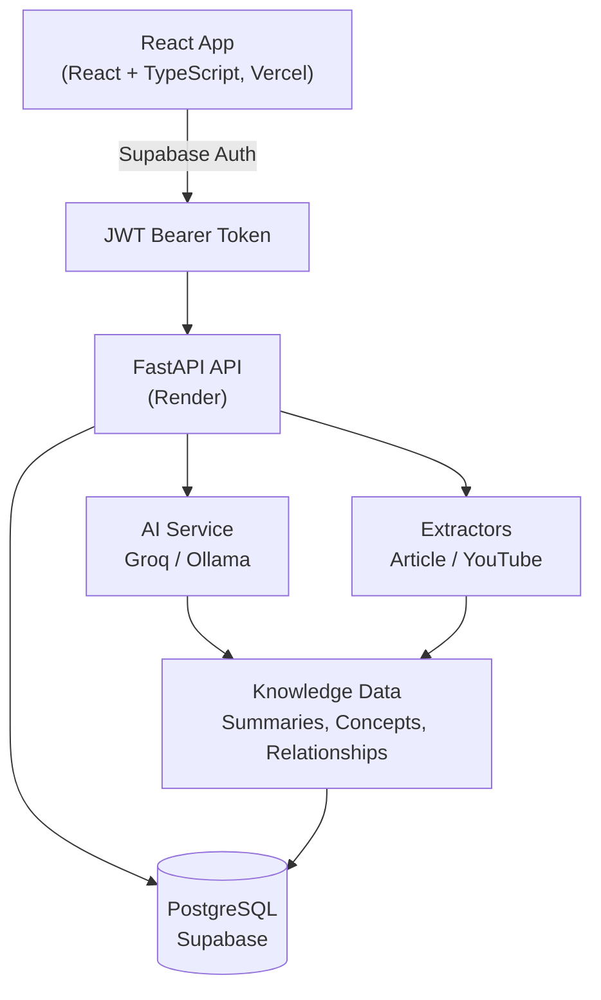

<div align="center">

# RabbitHole

**Turn scattered information into connected knowledge.**

An AI-powered personal knowledge management app that converts saved articles, YouTube videos, GitHub repositories, and text into structured, searchable, and interconnected knowledge.


</div>

---

## Table of Contents

- [Overview](#overview)
- [Features](#features)
- [Tech Stack](#tech-stack)
- [Architecture](#architecture)
- [Project Structure](#project-structure)
- [Getting Started](#getting-started)
- [Configuration](#configuration)
- [Authentication and Workspaces](#authentication-and-workspaces)
- [AI Providers](#ai-providers)
- [Testing](#testing)
- [Deployment](#deployment)
- [Security](#security)
- [Roadmap](#roadmap)
- [Contributing](#contributing)
- [License](#license)

---

## Overview

Bookmarking content and never revisiting it is a common failure of personal knowledge tools. RabbitHole closes that gap: it extracts **summaries, key takeaways, and concepts** from everything you save, then connects related ideas through an **interactive knowledge graph**.

Each user gets an independent, private workspace where saved resources and extracted knowledge stay organized and isolated.

## Features

### Resource ingestion
- Save articles, YouTube videos, GitHub repositories, and pasted text
- Automatic source-type detection
- Content and metadata extraction
- Processing status tracking: `Pending`, `Processing`, `Ready`, `Failed`
- Retry for resources that fail during processing

### AI-powered knowledge extraction
- Concise summaries of saved resources
- Extraction of key takeaways and important concepts
- Identification of relationships between concepts

### Interactive knowledge graph
- Visualize relationships between concepts
- Explore connections across saved resources
- Discover related ideas rather than browsing isolated bookmarks

### Personal knowledge library
- Browse all resources in one place
- Search by title, URL, and summary
- Detailed resource pages with personal notes
- Related resources and extracted concepts at a glance

### Ask RabbitHole
- Ask natural-language questions about your saved knowledge
- Answers grounded in your personal library
- No need to manually search through every resource

### Curiosity Trails
- Generated exploration paths through your saved knowledge
- Surface connections between previously saved ideas
- Topic discovery based on relationships in your knowledge graph

### Authentication and workspaces
- Supabase email/password authentication
- Email verification and expired-link recovery
- Automatic workspace provisioning for new users
- Workspace-level data isolation
- Optional workspace claiming via a claim token

## Tech Stack

| Layer | Technologies |
|---|---|
| **Frontend** | React 19, TypeScript, Vite |
| **Styling** | Tailwind CSS 4 |
| **Graph Visualization** | XYFlow / React Flow |
| **Backend** | Python, FastAPI |
| **ORM** | SQLAlchemy |
| **Database** | PostgreSQL (production), SQLite (local development) |
| **Migrations** | Alembic |
| **Authentication** | Supabase Auth, JWT verification |
| **AI Integration** | Groq API, Ollama |
| **Content Extraction** | Trafilatura, custom YouTube transcript extraction |
| **Testing** | Pytest, Vitest, React Testing Library |
| **Deployment** | Vercel, Render, Supabase |

## Architecture



### Resource processing flow

1. A user submits a URL or text through the frontend.
2. The backend validates the input and creates a resource.
3. Content is extracted from the source.
4. The configured LLM analyzes the extracted content.
5. Summaries, takeaways, and concepts are generated.
6. Concepts are stored and linked to their resources.
7. The frontend displays the processed resource and its connections.

## Project Structure

```text
RabbitHole/
├── backend/
│   ├── app/
│   │   ├── routers/          # API endpoints
│   │   ├── services/         # AI, extraction, and processing logic
│   │   ├── utils/            # Shared utilities
│   │   ├── models.py         # SQLAlchemy models
│   │   ├── schemas.py        # Pydantic schemas
│   │   ├── config.py         # Application configuration
│   │   ├── database.py       # Database connection
│   │   ├── deps.py           # Authentication and dependencies
│   │   └── main.py           # FastAPI application
│   ├── alembic/versions/     # Database migrations
│   ├── scripts/              # Utility and migration scripts
│   ├── tests/                # Backend tests
│   ├── requirements.txt
│   └── alembic.ini
│
├── frontend/
│   ├── src/
│   │   ├── api/              # Backend API clients
│   │   ├── components/       # Reusable UI components
│   │   ├── contexts/         # Authentication and app contexts
│   │   ├── pages/            # Application pages
│   │   ├── lib/              # Supabase and shared libraries
│   │   └── test/             # Test configuration
│   ├── package.json
│   └── vite.config.ts
│
└── README.md
```

## Getting Started

### Prerequisites

- Python 3.11+
- Node.js and npm
- Git
- A [Supabase](https://supabase.com) project
- A [Groq](https://groq.com) API key **or** a running [Ollama](https://ollama.com) instance
- A [Supadata](https://supadata.ai) API key (for YouTube transcript extraction)

### 1. Clone the repository

```bash
git clone https://github.com/420bunny69/RabbitHole.git
cd RabbitHole
```

### 2. Backend setup

```powershell
cd backend
python -m venv .venv
.\.venv\Scripts\Activate.ps1
pip install -r requirements.txt
```

Create a `.env` file in `backend/` (see [Configuration](#configuration)), then apply migrations and start the server:

```powershell
alembic upgrade head
python -m uvicorn app.main:app --reload
```

| Service | URL |
|---|---|
| API | http://127.0.0.1:8000 |
| Swagger docs | http://127.0.0.1:8000/docs |
| Health check | http://127.0.0.1:8000/api/health |

### 3. Frontend setup

In a new terminal:

```powershell
cd frontend
npm install
```

Create a `.env.local` file in `frontend/`:

```env
VITE_API_URL=
VITE_SUPABASE_URL=https://YOUR_PROJECT_REF.supabase.co
VITE_SUPABASE_ANON_KEY=your_supabase_publishable_or_anon_key
```

> For local development, leave `VITE_API_URL` empty. Vite proxies `/api` requests to `http://127.0.0.1:8000`.

```powershell
npm run dev
```

Open the URL printed by Vite (usually http://localhost:5173).

## Configuration

### Backend environment variables (`backend/.env`)

```env
APP_NAME=RabbitHole API

# Database
DATABASE_URL=sqlite:///./rabbithole.db

# Supabase JWT authentication
SUPABASE_JWT_ISSUER=https://YOUR_PROJECT_REF.supabase.co/auth/v1
SUPABASE_JWT_AUDIENCE=authenticated
SUPABASE_JWT_ALGORITHM=ES256

# CORS
CORS_ORIGINS=http://localhost:5173

# AI configuration
LLM_PROVIDER=groq
GROQ_API_KEY=your_groq_api_key
GROQ_MODEL=openai/gpt-oss-120b

# YouTube transcript extraction
SUPADATA_API_KEY=your_supadata_api_key
```

| Variable | Notes |
|---|---|
| `DATABASE_URL` | Defaults to SQLite locally. For PostgreSQL, use a SQLAlchemy-compatible URL such as `postgresql+psycopg://...` |
| `SUPABASE_JWT_ISSUER` | Must match your Supabase project's Auth issuer |
| `SUPABASE_JWT_ALGORITHM` | Must match the algorithm of your Supabase JWT signing keys (example uses `ES256`) |
| `CORS_ORIGINS` | Comma-separated list of allowed frontend origins |
| `GROQ_MODEL` | Must be a model currently available to your Groq account |

> ⚠️ Keep all API keys and database credentials private. Never commit `.env` files.

## Authentication and Workspaces

RabbitHole uses Supabase Auth for registration and login.

1. A user registers with an email address and password.
2. Supabase sends an email verification link.
3. After verification, the user can log in.
4. The frontend obtains a Supabase access token.
5. The backend verifies the JWT signature and claims.
6. The backend identifies the authenticated Supabase user.
7. If the user has no workspace, an independent workspace is provisioned automatically.
8. Subsequent requests use the existing workspace.

**Workspace isolation.** Each authenticated user is linked to one workspace through the `user_workspaces` table. The backend derives identity from the verified JWT and never trusts a user ID sent by the frontend. Resources and concepts are scoped to their workspace, so users cannot access another user's data through the standard API.

### Database migrations

```powershell
cd backend
alembic upgrade head   # apply migrations
alembic current        # inspect current revision
```

> ⚠️ Do not run the SQLite-to-PostgreSQL data migration script against an already populated production database. It is a one-time utility, not part of normal application startup.

## AI Providers

RabbitHole supports two LLM providers, selected with `LLM_PROVIDER`.

### Groq (hosted)

```env
LLM_PROVIDER=groq
GROQ_API_KEY=your_api_key
GROQ_MODEL=your_available_model
```

### Ollama (local)

```env
LLM_PROVIDER=ollama
OLLAMA_BASE_URL=http://localhost:11434
OLLAMA_MODEL=llama3.1
```

```bash
ollama pull llama3.1
```

Ensure the Ollama service is running before using the application.

## Testing

**Backend** (from `backend/`):

```powershell
python -m pytest
```

For PostgreSQL integration tests, use an isolated test database:

```powershell
$env:DATABASE_URL = "postgresql+psycopg://postgres@localhost:5432/rabbithole_test"
$env:PGPASSFILE = "$env:APPDATA\postgresql\pgpass.conf"
python -m pytest -v
```

> ⚠️ Never run integration tests against production data.

**Frontend** (from `frontend/`):

```bash
npm test            # unit and component tests
npm run lint        # linting
npm run build       # production build
```

## Deployment

Production uses three services:

| Service | Responsibility |
|---|---|
| **Vercel** | Frontend hosting |
| **Render** | FastAPI backend hosting |
| **Supabase** | PostgreSQL database and authentication |

### Frontend (Vercel)

| Setting | Value |
|---|---|
| Root directory | `frontend` |
| Framework | Vite |
| Install command | `npm install` |
| Build command | `npm run build` |
| Output directory | `dist` |

```env
VITE_API_URL=https://YOUR_BACKEND_URL
VITE_SUPABASE_URL=https://YOUR_PROJECT_REF.supabase.co
VITE_SUPABASE_ANON_KEY=your_publishable_or_anon_key
```

### Backend (Render)

| Setting | Value |
|---|---|
| Root directory | `backend` |
| Build command | `pip install -r requirements.txt` |
| Start command | `uvicorn app.main:app --host 0.0.0.0 --port $PORT` |

Required environment variables: `DATABASE_URL`, `SUPABASE_JWT_ISSUER`, `SUPABASE_JWT_AUDIENCE`, `SUPABASE_JWT_ALGORITHM`, `GROQ_API_KEY`, `GROQ_MODEL`, `SUPADATA_API_KEY`, `CORS_ORIGINS`.

Apply database migrations **before** deploying changes that depend on a new schema.

### Supabase

1. Provision the PostgreSQL database and connection credentials.
2. Enable email/password authentication.
3. Enable email verification.
4. Set the Site URL to the production frontend.
5. Add allowed redirect URLs for production and local development.

Use the Supabase session pooler (or another supported PostgreSQL connection method) for hosted backend access.

## Security

- Authentication enforced through verified Supabase JWTs
- Workspace ownership derived from the authenticated user, not client input
- Idempotent workspace provisioning backed by database uniqueness constraints
- CORS restricted to explicit allowed origins
- Database access scoped by workspace ownership
- Public URL validation during extraction to reduce SSRF risk
- Secrets kept in backend environment variables only
- Frontend uses only the Supabase publishable/anon key, never the service-role key

## Roadmap

- [ ] Richer knowledge graph exploration and filtering
- [ ] Improved semantic search across saved resources
- [ ] Additional source integrations
- [ ] Better resource processing observability
- [ ] Background job infrastructure for reliable large-scale processing
- [ ] Workspace export and backup
- [ ] Collaborative workspaces and shared knowledge collections

## Contributing

Contributions and suggestions are welcome.

1. Fork the repository
2. Create a feature branch
3. Make focused changes
4. Add or update tests
5. Run backend and frontend tests
6. Verify the frontend production build
7. Open a pull request with a clear description

## License

No license is currently specified. All rights remain with the repository owner unless a license is added.

---

<div align="center">

**RabbitHole: don't just save information. Connect it.**

</div>
